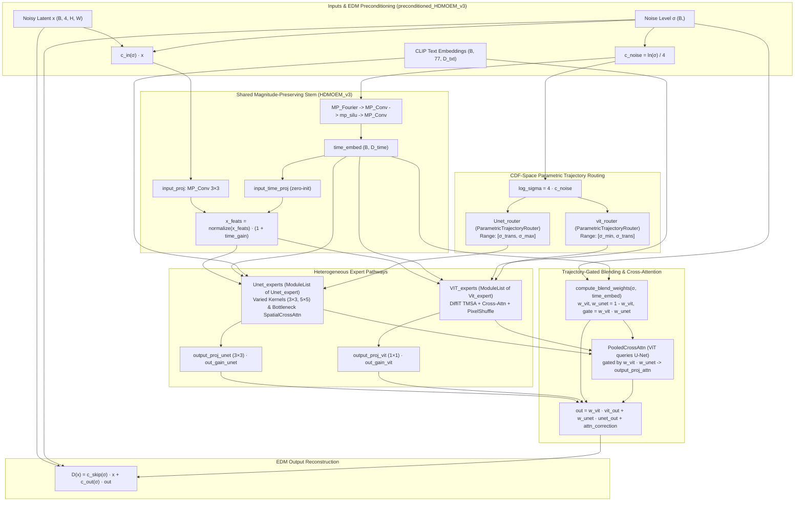

# Codebase Understanding & Guiding Innovation: Heterogeneous MoE for Diffusion Models (HDMOEM)

## 1. Executive Summary

This repository implements **HDMOEM (Hybrid/Heterogeneous Diffusion Mixture-of-Experts Model)**, a latent text-to-image diffusion framework built from scratch in PyTorch. 

Instead of relying on a single homogeneous backbone (such as a pure U-Net or a pure Diffusion Transformer / DiT) across the entire denoising trajectory, **HDMOEM combines architecturally distinct expert families—Convolutional U-Nets and DiffiT-style Vision Transformers (ViTs)—into a dual-branch, noise-routed Mixture-of-Experts system** operating on whitened Stable Diffusion VAE latents and conditioned on CLIP text embeddings.

The entire architecture is grounded in the theoretical foundations of **EDM** (*Elucidating the Design Space of Diffusion-Based Generative Models*, Karras et al. 2022) and **EDM2** (*Analyzing and Improving the Training Dynamics of Diffusion Models*, Karras et al. 2024), extending Magnitude-Preserving (MP) primitives to Vision Transformers, cross-branch attention, and parametric trajectory routers.

---

## 2. The Guiding Innovative Idea

The central research thesis driving this codebase is **Heterogeneous Architectural Specialization across the Diffusion Trajectory**, supported by five interconnected innovations:

### 2.1. Macro- & Micro-Level Architectural Heterogeneity
In standard diffusion models, every noise level $\sigma \in [\sigma_{\min}, \sigma_{\max}]$ is processed by the same network topology, even though the nature of the denoising task changes fundamentally from $\sigma = 80$ (pure Gaussian noise) to $\sigma = 0.002$ (nearly clean latent):
* **Macro-Level (Inter-Branch Specialization)**: HDMOEM splits the diffusion trajectory at a handoff noise level (`transition_sigma`, $\sigma_{\text{trans}} \approx 2.5 - 3.0$) between two fundamentally different inductive biases:
  * **U-Net Pathway** ([`Unet_expert`](file:///f:/Heterogeneous-MOE-for-Diffusion-models/models/model_components.py#L317-L502)): Multi-scale encoder-decoder networks with spatial convolutions and skip connections.
  * **Vision Transformer Pathway** ([`Vit_expert`](file:///f:/Heterogeneous-MOE-for-Diffusion-models/models/model_components.py#L649-L785)): Isotropic patch-based Transformers using Time-Dependent Multi-Head Self-Attention (TMSA, inspired by DiffiT) and PixelShuffle unpatchifying.
  * *Evolution of Regime Assignment across Model Versions*:
    * In earlier versions ([`HDMOEM` in `model_config.py`](file:///f:/Heterogeneous-MOE-for-Diffusion-models/models/model_config.py#L221-L237) and [`EDM_LOSS_LPD`](file:///f:/Heterogeneous-MOE-for-Diffusion-models/Utils/loss.py#L196-L327)), the codebase explored assigning **ViT to high noise / low-frequency global structure** and **U-Net to low noise / high-frequency local texture**.
    * In the latest architecture ([`HDMOEM_v3` in `model_config_v3.py`](file:///f:/Heterogeneous-MOE-for-Diffusion-models/models/model_config_v3.py#L154-L168) and [`configs.py`](file:///f:/Heterogeneous-MOE-for-Diffusion-models/Utils/configs.py#L91-L107)), the regime assignment is purposefully inverted: **U-Net experts specialize in the high-noise regime** ($\sigma \in [2.5, 80.0]$), using multi-scale spatial receptive fields ($3\times 3$ and $5\times 5$ kernels) to carve out coarse spatial layout from heavy noise, while **ViT experts with $1\times 1$ patch sizes specialize in the low-noise regime** ($\sigma \in [0.002, 2.5]$), leveraging unpooled $1:1$ token resolution and global self-attention to synthesize coherent fine-grained textures and semantic details.
* **Micro-Level (Intra-Branch Structural Diversity)**: Within each branch, individual experts are not merely copies with different random seeds—they are **architecturally heterogeneous**:
  * Different [`Unet_expert`](file:///f:/Heterogeneous-MOE-for-Diffusion-models/models/model_components.py#L317-L502) instances are configured with different convolutional `kernel_size` values (e.g., `(3, 3)` vs. `(5, 5)`) and different skip-connection `concat_balance` weights (e.g., `[0.7, 0.3]`).
  * Different [`Vit_expert`](file:///f:/Heterogeneous-MOE-for-Diffusion-models/models/model_components.py#L649-L785) instances can be configured with different `patch_size` values (e.g., `[2, 4]` or `[1, 1]`) and different embedding/positional balance factors.

### 2.2. CDF-Space Parametric Trajectory Routing & Curriculum Fencing
Standard MoE routers use linear/MLP layers over token embeddings or raw noise embeddings, which easily suffer from **expert collapse** or **uneven utilization** because EDM samples $\ln(\sigma) \sim \mathcal{N}(p_{\text{mean}}, p_{\text{std}}^2)$ non-uniformly.
* **Gaussian RBF Routing in CDF Percentile Space**: [`ParametricTrajectoryRouter`](file:///f:/Heterogeneous-MOE-for-Diffusion-models/models/model_components.py#L9-L90) maps incoming $\ln(\sigma)$ through the exact Cumulative Distribution Function (CDF) of the training noise schedule:
  $$\text{CDF}(\sigma) = \frac{1}{2}\left(1 + \operatorname{erf}\left(\frac{\ln(\sigma) - p_{\text{mean}}}{p_{\text{std}}\sqrt{2}}\right)\right) \in [0, 1]$$
  Each expert $i$ is parameterized by a learnable center $\mu_i \in (0, 1)$ (seeded equidistantly across its branch's log-noise sub-range and projected into CDF space) and a learnable log-sharpness $\ln(\gamma_i)$, producing Radial Basis Function (RBF) logits:
  $$\text{logit}_i(\sigma) = -\gamma_i \left(\text{CDF}(\sigma) - \mu_i\right)^2 + \zeta \cdot \epsilon$$
* **Rank-Based Curriculum Masking (`MaskGenerator`)**: [`MaskGenerator`](file:///f:/Heterogeneous-MOE-for-Diffusion-models/Utils/utils.py#L258-L349) ranks experts by their physical scale attribute (kernel size or patch size) and places hard binary fences in CDF space around each expert's center. A bandwidth scheduler gradually shrinks the allowed activation window from `bandwidth` to `min_bandwidth` over training, forcing wide collaborative overlap early on and strict noise-band specialization later.
* **Exploration-Exploitation Annealing (`ZetaScheduler`)**: [`ZetaScheduler`](file:///f:/Heterogeneous-MOE-for-Diffusion-models/Utils/utils.py#L221-L255) injects annealed Gaussian noise $\zeta$ into router logits during warmup and decays it via a cosine or exponential schedule.
* **Path Prior KL Regularization (`PathPriorLoss`)**: [`PathPriorLoss`](file:///f:/Heterogeneous-MOE-for-Diffusion-models/Utils/loss.py#L25-L51) penalizes the KL divergence between the router's softmax probabilities and the ideal Gaussian RBF target distribution in CDF space, preventing router drift.

### 2.3. Smooth Trajectory Handoff & Transition-Gated Cross-Attention
Switching between a U-Net and a ViT mid-sampling at $\sigma = \sigma_{\text{trans}}$ risks creating a sharp discontinuity in the ODE vector field $\frac{dx}{d\sigma}$ (which manifests as a velocity spike during Heun integration). [`HDMOEM_v3`](file:///f:/Heterogeneous-MOE-for-Diffusion-models/models/model_config_v3.py#L45-L380) solves this via two mechanisms:
1. **Prior + Bounded Learned Residual Blending** ([`compute_blend_weights`](file:///f:/Heterogeneous-MOE-for-Diffusion-models/models/model_config_v3.py#L262-L283)):
   $$w_{\text{vit}}(\sigma) = \sigma_{\text{sigmoid}}\!\left(\frac{\ln(\sigma_{\text{trans}}) - \ln(\sigma)}{\tau_{\text{sharpness}}} + 1.5 \tanh(\text{MLP}(e_{\text{time}}))\right), \quad w_{\text{unet}}(\sigma) = 1 - w_{\text{vit}}(\sigma)$$
2. **Trajectory-Gated Inter-Branch Cross-Attention** ([`PooledCrossAttn`](file:///f:/Heterogeneous-MOE-for-Diffusion-models/models/model_internals.py#L450-L543)):
   * Computes cross-attention where the ViT feature map queries the U-Net feature map, modulated by the **transition gate**:
     $$g(\sigma) = w_{\text{vit}}(\sigma) \cdot w_{\text{unet}}(\sigma) \in [0, 0.25]$$
   * At extreme high noise ($w_{\text{unet}} \to 1, w_{\text{vit}} \to 0$) or extreme low noise ($w_{\text{vit}} \to 1, w_{\text{unet}} \to 0$), $g(\sigma) \to 0$, isolating the active branch.
   * Right at the handoff ($\sigma \approx \sigma_{\text{trans}}$), $g(\sigma)$ reaches its maximum of $0.25$, enabling maximal cross-branch feature communication so the incoming ViT branch inherits structural coherence from the outgoing U-Net branch:
     $$\text{out} = w_{\text{vit}} \cdot \text{vit\_out} + w_{\text{unet}} \cdot \text{unet\_out} + \text{output\_proj\_attn}\big(g(\sigma) \cdot \text{CrossAttn}(\text{vit\_feat}, \text{unet\_feat})\big)$$

### 2.4. Orthogonal / Smoothly-Decaying Branch Supervision
To prevent one branch from "free-riding" on the other during the overlap zone, [`Utils/loss.py`](file:///f:/Heterogeneous-MOE-for-Diffusion-models/Utils/loss.py) implements specialized multi-branch loss formulations on top of EDM's uncertainty-weighted loss:
* **$C^\infty$ Smooth Trajectory Decomposition (`EDM_LOSS_NOD`)**: [`EDM_LOSS_NOD`](file:///f:/Heterogeneous-MOE-for-Diffusion-models/Utils/loss.py#L53-L194) supervises not only the final blended prediction $D(x)$, but also the individual EDM-preconditioned branch predictions $D_{\text{unet}}(x)$ and $D_{\text{vit}}(x)$, weighted by their continuous blend weights $w_{\text{unet}}(\sigma)$ and $w_{\text{vit}}(\sigma)$:
  $$\mathcal{L}_{\text{traj}} = \alpha_{\text{blend}} \mathcal{L}_{\text{EDM}}(D(x), x) + \alpha_{\text{unet}} \mathbb{E}\big[\lambda(\sigma) w_{\text{unet}}(\sigma) \|D_{\text{unet}}(x) - x\|^2\big] + \alpha_{\text{vit}} \mathbb{E}\big[\lambda(\sigma) w_{\text{vit}}(\sigma) \|D_{\text{vit}}(x) - x\|^2\big]$$
* **Laplacian Pyramid Frequency Decomposition (`EDM_LOSS_LPD`)**: [`EDM_LOSS_LPD`](file:///f:/Heterogeneous-MOE-for-Diffusion-models/Utils/loss.py#L196-L327) decomposes the ideal preconditioned target $F_{\text{target}} = \frac{x - c_{\text{skip}} x_{\text{noisy}}}{c_{\text{out}}}$ into a Gaussian-blurred low-frequency structural target $F_{\text{low}}$ and a Laplacian high-frequency residual target $F_{\text{high}} = F_{\text{target}} - F_{\text{low}}$ via [`laplacian_decomposition`](file:///f:/Heterogeneous-MOE-for-Diffusion-models/Utils/loss.py#L8-L22), explicitly forcing orthogonal frequency specialization between the two pathways.

### 2.5. EDM2 Magnitude Preservation Across Hybrid U-Net + ViT Topologies
Standard Transformer layers (LayerNorm, unnormalized residual additions, standard attention) violate the strict unit-variance signal propagation assumptions of Karras et al.'s EDM2. In [`models/model_internals.py`](file:///f:/Heterogeneous-MOE-for-Diffusion-models/models/model_internals.py), the codebase generalizes EDM2's Magnitude-Preserving (MP) design to both U-Net and Vision Transformer primitives:
* [`normalize`](file:///f:/Heterogeneous-MOE-for-Diffusion-models/models/model_internals.py#L8-L31): RMS hypersphere projection.
* [`mp_silu`](file:///f:/Heterogeneous-MOE-for-Diffusion-models/models/model_internals.py#L33-L47), [`mp_sum`](file:///f:/Heterogeneous-MOE-for-Diffusion-models/models/model_internals.py#L50-L66), [`mp_cat`](file:///f:/Heterogeneous-MOE-for-Diffusion-models/models/model_internals.py#L69-L92): Variance-preserving activation, residual blending, and skip concatenation.
* [`MP_Conv`](file:///f:/Heterogeneous-MOE-for-Diffusion-models/models/model_internals.py#L236-L309): Forced weight normalization during training (`self.weights.copy_(normalize(w))`) and fan-in magnitude scaling (`gain / sqrt(fan_in)`), unified for both 2D linear projections and 4D spatial convolutions.
* [`MP_Pos_encoding_2D`](file:///f:/Heterogeneous-MOE-for-Diffusion-models/models/model_internals.py#L178-L234) & [`MP_Attention`](file:///f:/Heterogeneous-MOE-for-Diffusion-models/models/model_internals.py#L312-L448): Unit-variance 2D sinusoidal positional embeddings blended via `mp_sum`, and Magnitude-Preserving Self/Cross-Attention with learnable relative positional bias and time-injected $Q, K, V$ projections.

---

## 3. End-to-End Architecture Diagram (`HDMOEM_v3`)

---

## 4. Repository Structure & Module Breakdown

### 4.1. `models/` — Core Neural Network Architecture
| File | Key Classes / Functions | Role in the Codebase |
| :--- | :--- | :--- |
| [`models/model_internals.py`](file:///f:/Heterogeneous-MOE-for-Diffusion-models/models/model_internals.py) | [`normalize`](file:///f:/Heterogeneous-MOE-for-Diffusion-models/models/model_internals.py#L8-L31), [`mp_silu`](file:///f:/Heterogeneous-MOE-for-Diffusion-models/models/model_internals.py#L33-L47), [`mp_sum`](file:///f:/Heterogeneous-MOE-for-Diffusion-models/models/model_internals.py#L50-L66), [`mp_cat`](file:///f:/Heterogeneous-MOE-for-Diffusion-models/models/model_internals.py#L69-L92), [`resample`](file:///f:/Heterogeneous-MOE-for-Diffusion-models/models/model_internals.py#L95-L127), [`MP_Fourier`](file:///f:/Heterogeneous-MOE-for-Diffusion-models/models/model_internals.py#L130-L175), [`MP_Pos_encoding_2D`](file:///f:/Heterogeneous-MOE-for-Diffusion-models/models/model_internals.py#L178-L234), [`MP_Conv`](file:///f:/Heterogeneous-MOE-for-Diffusion-models/models/model_internals.py#L236-L309), [`MP_Attention`](file:///f:/Heterogeneous-MOE-for-Diffusion-models/models/model_internals.py#L312-L448), [`PooledCrossAttn`](file:///f:/Heterogeneous-MOE-for-Diffusion-models/models/model_internals.py#L450-L543) | Low-level EDM2 Magnitude-Preserving layers, 2D sinusoidal positional encodings, time-dependent multi-head attention with relative positional bias, and the trajectory-gated inter-branch cross-attention module. |
| [`models/model_components.py`](file:///f:/Heterogeneous-MOE-for-Diffusion-models/models/model_components.py) | [`ParametricTrajectoryRouter`](file:///f:/Heterogeneous-MOE-for-Diffusion-models/models/model_components.py#L9-L90), [`Scaling_router`](file:///f:/Heterogeneous-MOE-for-Diffusion-models/models/model_components.py#L92-L150), [`Router`](file:///f:/Heterogeneous-MOE-for-Diffusion-models/models/model_components.py#L152-L205), [`SpatialCrossAttn`](file:///f:/Heterogeneous-MOE-for-Diffusion-models/models/model_components.py#L207-L225), [`Unet_block`](file:///f:/Heterogeneous-MOE-for-Diffusion-models/models/model_components.py#L227-L315), [`Unet_expert`](file:///f:/Heterogeneous-MOE-for-Diffusion-models/models/model_components.py#L317-L502), [`Vit_block`](file:///f:/Heterogeneous-MOE-for-Diffusion-models/models/model_components.py#L505-L647), [`Vit_expert`](file:///f:/Heterogeneous-MOE-for-Diffusion-models/models/model_components.py#L649-L785) | Building blocks of the routers and heterogeneous experts. Implements the CDF-space Gaussian RBF router, MP U-Net blocks/experts with bottleneck text cross-attention, and DiffiT-based ViT blocks/experts. |
| [`models/model_config_v3.py`](file:///f:/Heterogeneous-MOE-for-Diffusion-models/models/model_config_v3.py) | [`router_to_experts`](file:///f:/Heterogeneous-MOE-for-Diffusion-models/models/model_config_v3.py#L11-L43), [`HDMOEM_v3`](file:///f:/Heterogeneous-MOE-for-Diffusion-models/models/model_config_v3.py#L45-L380), [`preconditioned_HDMOEM_v3`](file:///f:/Heterogeneous-MOE-for-Diffusion-models/models/model_config_v3.py#L383-L540) | **Primary active model architecture.** Integrates `ParametricTrajectoryRouter`, `Unet_experts`, `VIT_experts`, learned residual blending (`compute_blend_weights`), `PooledCrossAttn`, and the EDM preconditioning + uncertainty (`log_var`) wrapper. |
| [`models/model_config.py`](file:///f:/Heterogeneous-MOE-for-Diffusion-models/models/model_config.py), [`model_config1.py`](file:///f:/Heterogeneous-MOE-for-Diffusion-models/models/model_config1.py), [`model_config2.py`](file:///f:/Heterogeneous-MOE-for-Diffusion-models/models/model_config2.py) | [`HDMOEM`](file:///f:/Heterogeneous-MOE-for-Diffusion-models/models/model_config.py#L46-L325), [`preconditioned_HDMOEM`](file:///f:/Heterogeneous-MOE-for-Diffusion-models/models/model_config.py#L328-L506) | Earlier architectural iterations (v1/v2) documenting the evolution from MLP top-$k$ routers and softmax gating networks to deterministic/residual sigmoid trajectory handoffs. |

### 4.2. `Utils/` — Training, Losses, Sampling, and Latent/Text Encoders
| File | Key Classes / Functions | Role in the Codebase |
| :--- | :--- | :--- |
| [`Utils/loss.py`](file:///f:/Heterogeneous-MOE-for-Diffusion-models/Utils/loss.py) | [`PathPriorLoss`](file:///f:/Heterogeneous-MOE-for-Diffusion-models/Utils/loss.py#L25-L51), [`EDM_LOSS_NOD`](file:///f:/Heterogeneous-MOE-for-Diffusion-models/Utils/loss.py#L53-L194), [`EDM_LOSS_LPD`](file:///f:/Heterogeneous-MOE-for-Diffusion-models/Utils/loss.py#L196-L327), [`EDM_LOSS`](file:///f:/Heterogeneous-MOE-for-Diffusion-models/Utils/loss.py#L329-L406) | Loss functions combining EDM uncertainty-weighted MSE, smooth branch-specific trajectory losses (`EDM_LOSS_NOD`), Laplacian Pyramid frequency-split losses (`EDM_LOSS_LPD`), Switch-style load balancing, router z-loss, and CDF-space KL path prior loss. |
| [`Utils/utils.py`](file:///f:/Heterogeneous-MOE-for-Diffusion-models/Utils/utils.py) | [`sample_sigma_hybrid`](file:///f:/Heterogeneous-MOE-for-Diffusion-models/Utils/utils.py#L64-L85), [`Lr_Scheduler`](file:///f:/Heterogeneous-MOE-for-Diffusion-models/Utils/utils.py#L129-L219), [`ZetaScheduler`](file:///f:/Heterogeneous-MOE-for-Diffusion-models/Utils/utils.py#L221-L255), [`MaskGenerator`](file:///f:/Heterogeneous-MOE-for-Diffusion-models/Utils/utils.py#L258-L349), [`EMA`](file:///f:/Heterogeneous-MOE-for-Diffusion-models/Utils/utils.py#L351-L403) | Training utilities: hybrid log-normal + log-uniform noise sampling (ensuring tail coverage at $\sigma_{\min}$ and $\sigma_{\max}$), EDM2 multi-group inverse-sqrt LR scheduler, router exploration noise scheduler, CDF-space rank-based expert mask generator, and power-warmup Exponential Moving Average. |
| [`Utils/VAE_CLIP.py`](file:///f:/Heterogeneous-MOE-for-Diffusion-models/Utils/VAE_CLIP.py) | [`StabilityVAE`](file:///f:/Heterogeneous-MOE-for-Diffusion-models/Utils/VAE_CLIP.py#L7-L100), [`CLIP_EMBED`](file:///f:/Heterogeneous-MOE-for-Diffusion-models/Utils/VAE_CLIP.py#L102-L151) | Wraps `stabilityai/sd-vae-ft-mse` with **channel-wise affine whitening** so encoded latents strictly match EDM's $\mathcal{N}(0, \sigma_{\text{data}}^2)$ distribution, and wraps `openai/clip-vit-large-patch14` for $(B, 77, 768)$ text conditioning. |
| [`Utils/EDM_sampler.py`](file:///f:/Heterogeneous-MOE-for-Diffusion-models/Utils/EDM_sampler.py) | [`EDM_Sampler`](file:///f:/Heterogeneous-MOE-for-Diffusion-models/Utils/EDM_sampler.py#L7-L98) | 2nd-order deterministic/stochastic **Heun ODE/SDE solver** with $\rho$-parametrized noise steps, stochastic churn ($S_{\text{churn}}, S_{\min}, S_{\max}, S_{\text{noise}}$), and Classifier-Free Guidance (CFG). |
| [`Utils/training.py`](file:///f:/Heterogeneous-MOE-for-Diffusion-models/Utils/training.py) | [`training_HDMOE`](file:///f:/Heterogeneous-MOE-for-Diffusion-models/Utils/training.py#L14-L367) | Full training loop with per-component differential learning rates (e.g. separate LRs for U-Net experts, ViT experts, routers, blend residuals, and cross-attention), checkpoint resumption, and real-time diagnostic logging. |
| [`Utils/configs.py`](file:///f:/Heterogeneous-MOE-for-Diffusion-models/Utils/configs.py) | `model_configs`, `loss_configs`, `optim_configs`, `mask_configs`, `zeta_configs` | Central hyperparameter dictionaries defining the model topology, dataset statistics, per-group learning rates, and CDF mask bandwidths. |
| [`Utils/generate_test.py`](file:///f:/Heterogeneous-MOE-for-Diffusion-models/Utils/generate_test.py) | [`debug_trajectory_sampler`](file:///f:/Heterogeneous-MOE-for-Diffusion-models/Utils/generate_test.py#L13-L82), [`test_diffusion_pipeline`](file:///f:/Heterogeneous-MOE-for-Diffusion-models/Utils/generate_test.py#L84-L441), [`sample_and_save`](file:///f:/Heterogeneous-MOE-for-Diffusion-models/Utils/generate_test.py#L443-L618) | End-to-end inference and diagnostic harness: tests VAE round-trip reconstruction, single-step denoising improvement, full Heun trajectory frame-by-frame decoding, and guided sample generation. |

### 4.3. `data_augmentation/` — Dataset & Streaming Pipelines
* [`data_augmentation/data_collector.py`](file:///f:/Heterogeneous-MOE-for-Diffusion-models/data_augmentation/data_collector.py): Provides three data loading pipelines:
  1. [`get_dataloader`](file:///f:/Heterogeneous-MOE-for-Diffusion-models/data_augmentation/data_collector.py#L7-L32): Downloads and concatenates `Flowers102` splits with basic augmentations.
  2. [`get_dataloader_path`](file:///f:/Heterogeneous-MOE-for-Diffusion-models/data_augmentation/data_collector.py#L34-L70): Local `ImageFolder` loader (e.g. for LHQ-1024 landscape datasets).
  3. [`get_dataloader_hf`](file:///f:/Heterogeneous-MOE-for-Diffusion-models/data_augmentation/data_collector.py#L78-L155): Streaming HuggingFace WebDataset loader for `jackyhate/text-to-image-2M`, filtering for nature/landscape captions on the fly.

### 4.4. `graphs/` — Research Telemetry, Spectral Diagnostics & Plotting
* [`graphs/logger2.py`](file:///f:/Heterogeneous-MOE-for-Diffusion-models/graphs/logger2.py) ([`Logger`](file:///f:/Heterogeneous-MOE-for-Diffusion-models/graphs/logger2.py#L75-L561)): Streams structured JSONL telemetry across 5 diagnostic channels:
  1. **Training**: Losses, MSE, learning rate, $\zeta$, and batch distribution across ViT-dominant, overlap, and U-Net-dominant trajectory zones.
  2. **Router Health**: Normalized Shannon entropy, discrete **Gini coefficient** (Brown's formula), dead-expert detection, and online 2D activation histograms across $\sigma$ bins.
  3. **Gradient Health**: Component-wise parameter-update-to-weight ratios $\frac{\|\nabla W\| \cdot \text{lr}}{\|W\|}$ (checking against the ideal $10^{-3}$ update band) and **depth-resolved gradient norms** (encoder vs. decoder for U-Net; early blocks vs. late blocks for ViT) to catch vanishing gradients.
  4. **Branch Specialization**: Per-$\sigma$-bin $L_2$ divergence, cosine similarity, and spatial variance between `vit_out` and `unet_out` to detect branch collapse.
  5. **Checkpoints**: Automated pass/fail health gates at each saved checkpoint.
* [`graphs/plotter2.py`](file:///f:/Heterogeneous-MOE-for-Diffusion-models/graphs/plotter2.py) ([`Plotter`](file:///f:/Heterogeneous-MOE-for-Diffusion-models/graphs/plotter2.py#L98-L451)): Parses the JSONL logs to generate publication-grade multi-panel diagnostic figures (`01_training_overview.png` through `05_checkpoint_timeline.png`).
* [`graphs/diagnostic_sampler.py`](file:///f:/Heterogeneous-MOE-for-Diffusion-models/graphs/diagnostic_sampler.py) ([`Diagnostic_EDM_Sampler`](file:///f:/Heterogeneous-MOE-for-Diffusion-models/graphs/diagnostic_sampler.py#L8-L52), [`analyze_trajectory`](file:///f:/Heterogeneous-MOE-for-Diffusion-models/graphs/diagnostic_sampler.py#L93-L172)): Intercepts $\hat{x}_0 = D_\theta(x_t, \sigma_t)$ at every ODE step during sampling and computes the **Radially Averaged Power Spectral Density (RAPSD)** via 2D FFT, plotting frequency band assembly over time and monitoring the $L_2$ trajectory velocity $\|\hat{x}_0^{(t)} - \hat{x}_0^{(t-1)}\|_2$ for handoff spikes at $\sigma_{\text{trans}}$.

### 4.5. `tests/` — Unit & Regression Test Suites
* [`tests/files/`](file:///f:/Heterogeneous-MOE-for-Diffusion-models/tests/files/README.md): A comprehensive unit test suite verifying EDM preconditioning closed-form limits (`test_edm_preconditioning.py`), EDM2 unit-variance preservation (`test_magnitude_preservation.py`), router simplex/masking invariants (`test_router.py`), numerical stability (`test_numerical_stability.py`), train/eval determinism (`test_train_inference_modes.py`), Time-Gated Frequency Fusion (`test_tgff.py`), and end-to-end gradient flow (`test_gradient_flow.py`)—specifically designed to catch "zero-initialization deadlocks" when two zero-initialized projection layers are stacked in series.
* [`tests/test_model/`](file:///f:/Heterogeneous-MOE-for-Diffusion-models/tests/test_model/) & [`tests/test_utilities/`](file:///f:/Heterogeneous-MOE-for-Diffusion-models/tests/test_utilities/): Component-level unit tests for U-Net blocks/experts, ViT attention/blocks/experts, routers, mask generators, losses, EDM sampler, and VAE/CLIP wrappers.
